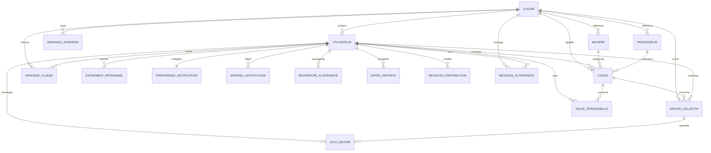

# Modèle de données initial

Ce modèle couvre le MVP de Swikko Pro pour un établissement, plusieurs classes possibles, des élèves pouvant être délégués et un module public de recherche d’alternances.

## 1. Principes de modélisation

- Les identifiants sont des UUID.
- Toutes les dates techniques sont stockées en UTC.
- Les dates et heures scolaires sont exposées dans le fuseau horaire de l’établissement.
- Un délégué reste un élève avec des droits supplémentaires limités.
- Les élèves contribuent collectivement aux cours, devoirs et projets.
- Les corrections de cours sont immédiates pour tout membre approuvé, sans workflow de validation.
- Les données scolaires sont toujours rattachées à une classe.
- Un code valide crée une demande ; seule l’approbation d’un délégué ouvre l’accès scolaire.
- Les données permettant d’identifier un professeur, une salle ou un horaire précis sont chiffrées avant écriture.
- La progression d’un devoir collectif appartient à chaque élève.
- Les offres externes ne sont pas toutes recopiées en base.
- Les suppressions de comptes et de données collectives doivent être contrôlées.

## 2. Vue relationnelle

## 3. Tables scolaires

### `classes`

| Colonne | Type | Règle |
| :--- | :--- | :--- |
| `id` | UUID | Clé primaire |
| `nom` | VARCHAR(80) | Obligatoire et unique |
| `annee_scolaire` | VARCHAR(9) | Format attendu : `2026-2027` |
| `code_acces_hash` | TEXT | Empreinte du code actif, jamais le code en clair |
| `code_acces_chiffre` | TEXT | Valeur chiffrée, lisible uniquement par une route délégué autorisée |
| `code_acces_updated_at` | TIMESTAMPTZ | Date du dernier renouvellement |
| `est_active` | BOOLEAN | Vrai par défaut |
| `created_at` | TIMESTAMPTZ | Obligatoire |
| `updated_at` | TIMESTAMPTZ | Obligatoire |
| `created_by_id` | UUID | Premier délégué ayant créé la classe |

### `utilisateurs`

Cette table complète les tables techniques fournies par ASP.NET Core Identity.

| Colonne | Type | Règle |
| :--- | :--- | :--- |
| `id` | UUID | Clé primaire Identity |
| `email` | VARCHAR(320) | Obligatoire et unique |
| `prenom` | VARCHAR(80) | Obligatoire |
| `nom` | VARCHAR(80) | Obligatoire |
| `classe_id` | UUID nullable | Vide tant que l’utilisateur n’a pas rejoint une classe |
| `est_actif` | BOOLEAN | Vrai par défaut |
| `created_at` | TIMESTAMPTZ | Obligatoire |
| `updated_at` | TIMESTAMPTZ | Obligatoire |

Les rôles `Eleve` et `Delegue` sont gérés par ASP.NET Core Identity. Un compte sans classe ne possède aucun de ces rôles. Le rôle `Eleve` et le `classe_id` ne sont attribués qu’après approbation. Le créateur d’une classe reçoit immédiatement les rôles `Eleve` et `Delegue`.

### `demandes_adhesion_classe`

| Colonne | Type | Règle |
| :--- | :--- | :--- |
| `id` | UUID | Clé primaire |
| `classe_id` | UUID | Classe demandée |
| `utilisateur_id` | UUID | Demandeur sans accès scolaire |
| `statut` | VARCHAR(20) | `EnAttente`, `Approuvee`, `Refusee` ou `Annulee` |
| `requested_at` | TIMESTAMPTZ | Obligatoire |
| `decided_at` | TIMESTAMPTZ nullable | Date de décision |
| `decided_by_id` | UUID nullable | Délégué ayant décidé |

Une seule demande en attente est autorisée par utilisateur. La classe et ses données ne sont jamais chargées depuis cette demande avant approbation.

### `matieres`

| Colonne | Type | Règle |
| :--- | :--- | :--- |
| `id` | UUID | Clé primaire |
| `classe_id` | UUID | Obligatoire |
| `nom` | VARCHAR(120) | Obligatoire, unique dans la classe |
| `est_active` | BOOLEAN | Vrai par défaut |
| `created_by_id` | UUID | Délégué créateur |
| `created_at` | TIMESTAMPTZ | Obligatoire |

### `professeurs`

Un professeur est une information partagée, pas un compte utilisateur.

| Colonne | Type | Règle |
| :--- | :--- | :--- |
| `id` | UUID | Clé primaire |
| `classe_id` | UUID | Obligatoire |
| `nom_affiche_chiffre` | TEXT | Nom chiffré par l’application |
| `nom_recherche_hash` | VARCHAR(64) | HMAC normalisé pour détecter un doublon sans exposer le nom |
| `informations_chiffrees` | TEXT nullable | Informations facultatives chiffrées |
| `est_actif` | BOOLEAN | Vrai par défaut |
| `created_by_id` | UUID | Délégué créateur |
| `created_at` | TIMESTAMPTZ | Obligatoire |

### `cours`

Pour le MVP, chaque ligne représente une occurrence réellement affichée dans le calendrier. Lors de la création d’un cours récurrent, l’API génère les occurrences jusqu’à la date de fin choisie.

| Colonne | Type | Règle |
| :--- | :--- | :--- |
| `id` | UUID | Clé primaire |
| `classe_id` | UUID | Obligatoire, clé étrangère vers `classes` |
| `serie_id` | UUID nullable | Regroupe les occurrences d’une répétition |
| `matiere_id` | UUID | Obligatoire, matière de la même classe |
| `date_jour` | DATE | Jour local indexable, sans horaire précis |
| `donnees_chiffrees` | TEXT | Horaire de début/fin, salle et intitulé chiffrés |
| `professeur_id` | UUID nullable | Professeur de la même classe |
| `est_annule` | BOOLEAN | Faux par défaut |
| `motif_annulation` | VARCHAR(300) nullable | Facultatif |
| `created_by_id` | UUID | Élève contributeur |
| `updated_by_id` | UUID nullable | Dernier élève contributeur |
| `created_at` | TIMESTAMPTZ | Obligatoire |
| `updated_at` | TIMESTAMPTZ | Obligatoire |
| `deleted_at` | TIMESTAMPTZ nullable | Suppression logique |

Un index est créé sur `(classe_id, date_jour)`. L’API charge les événements du jour, déchiffre leurs horaires en mémoire, puis contrôle les conflits. La contrainte fin après début est vérifiée avant chiffrement.

### `devoirs_collectifs`

| Colonne | Type | Règle |
| :--- | :--- | :--- |
| `id` | UUID | Clé primaire |
| `classe_id` | UUID | Obligatoire |
| `cours_id` | UUID nullable | Cours associé facultatif |
| `titre` | VARCHAR(160) | Obligatoire |
| `description` | TEXT nullable | Facultatif |
| `deadline` | TIMESTAMPTZ | Obligatoire |
| `created_by_id` | UUID | Élève contributeur |
| `updated_by_id` | UUID nullable | Dernier élève contributeur |
| `created_at` | TIMESTAMPTZ | Obligatoire |
| `updated_at` | TIMESTAMPTZ | Obligatoire |
| `deleted_at` | TIMESTAMPTZ nullable | Suppression logique |

### `suivis_devoirs`

Cette table contient l’état individuel d’un devoir collectif.

| Colonne | Type | Règle |
| :--- | :--- | :--- |
| `id` | UUID | Clé primaire |
| `devoir_id` | UUID | Clé étrangère vers `devoirs_collectifs` |
| `utilisateur_id` | UUID | Clé étrangère vers `utilisateurs` |
| `est_termine` | BOOLEAN | Faux par défaut |
| `notification_active` | BOOLEAN | Vrai par défaut |
| `completed_at` | TIMESTAMPTZ nullable | Date de réalisation |

La paire `(devoir_id, utilisateur_id)` est unique.

### `taches_personnelles`

| Colonne | Type | Règle |
| :--- | :--- | :--- |
| `id` | UUID | Clé primaire |
| `utilisateur_id` | UUID | Propriétaire obligatoire |
| `cours_id` | UUID nullable | Cours associé facultatif |
| `titre` | VARCHAR(160) | Obligatoire |
| `description` | TEXT nullable | Facultatif |
| `deadline` | TIMESTAMPTZ nullable | Facultatif |
| `est_terminee` | BOOLEAN | Faux par défaut |
| `notification_active` | BOOLEAN | Faux si aucune échéance |
| `categorie` | VARCHAR(20) | `Ecole`, `Alternance` ou `Entreprise` |
| `completed_at` | TIMESTAMPTZ nullable | Date de réalisation |
| `created_at` | TIMESTAMPTZ | Obligatoire |
| `updated_at` | TIMESTAMPTZ | Obligatoire |

### `evenements_personnels`

Ces événements alimentent l’emploi du temps personnel, même sans classe.

| Colonne | Type | Règle |
| :--- | :--- | :--- |
| `id` | UUID | Clé primaire |
| `utilisateur_id` | UUID | Propriétaire obligatoire |
| `date_jour` | DATE | Jour indexable |
| `donnees_chiffrees` | TEXT | Titre, horaire précis, lieu et notes chiffrés |
| `categorie` | VARCHAR(20) | `Alternance`, `Entreprise` ou `Personnel` |
| `notification_active` | BOOLEAN | Faux par défaut |
| `created_at` | TIMESTAMPTZ | Obligatoire |
| `updated_at` | TIMESTAMPTZ | Obligatoire |

## 4. Notifications

### `preferences_notifications`

| Colonne | Type | Règle |
| :--- | :--- | :--- |
| `id` | UUID | Clé primaire |
| `utilisateur_id` | UUID | Unique et obligatoire |
| `cours_actifs` | BOOLEAN | Vrai par défaut |
| `devoirs_actifs` | BOOLEAN | Vrai par défaut |
| `alternances_actives` | BOOLEAN | Faux par défaut |
| `cours_rappel_minutes` | INTEGER | 5 par défaut ; valeurs autorisées 0, 5, 10, 15, 30 ou 60 |

### `appareils_notifications`

| Colonne | Type | Règle |
| :--- | :--- | :--- |
| `id` | UUID | Clé primaire |
| `utilisateur_id` | UUID | Obligatoire |
| `token_hash` | VARCHAR(64) | HMAC du token, obligatoire et unique |
| `encrypted_token` | TEXT | Token chiffré, nécessaire au futur envoi push |
| `plateforme` | VARCHAR(20) | `Android`, `iOS` ou `Web` |
| `derniere_activite_at` | TIMESTAMPTZ | Obligatoire |

### `revisions_contributions`

Cette table fournit un historique minimal des cours et devoirs modifiés collectivement.

| Colonne | Type | Règle |
| :--- | :--- | :--- |
| `id` | UUID | Clé primaire |
| `classe_id` | UUID | Obligatoire |
| `entite_type` | VARCHAR(30) | `Cours` ou `DevoirCollectif` |
| `entite_id` | UUID | Identifiant de la contribution |
| `action` | VARCHAR(20) | `Creation`, `Modification`, `Suppression` ou `Restauration` |
| `snapshot_chiffre` | TEXT | État précédent chiffré avant la modification |
| `auteur_id` | UUID | Élève ayant effectué l’action |
| `created_at` | TIMESTAMPTZ | Obligatoire |

## 5. Fil d’informations

### `annonces_classe`

| Colonne | Type | Règle |
| :--- | :--- | :--- |
| `id` | UUID | Clé primaire |
| `classe_id` | UUID | Obligatoire |
| `auteur_id` | UUID | Délégué de la même classe |
| `contenu` | VARCHAR(2000) | Obligatoire |
| `est_epingle` | BOOLEAN | Faux par défaut |
| `created_at` | TIMESTAMPTZ | Obligatoire |
| `updated_at` | TIMESTAMPTZ nullable | Facultatif |
| `deleted_at` | TIMESTAMPTZ nullable | Suppression logique |

Les annonces épinglées sont affichées sur le tableau de bord. Elles ne contiennent aucun chat généraliste ; le canal d’entraide alternance est stocké séparément dans `messages_alternance`.

## 6. Alternances

### `recherches_alternance`

| Colonne | Type | Règle |
| :--- | :--- | :--- |
| `id` | UUID | Clé primaire |
| `utilisateur_id` | UUID | Obligatoire |
| `nom` | VARCHAR(100) | Nom choisi par l’utilisateur |
| `mots_cles` | VARCHAR(200) | Obligatoire |
| `localisation` | VARCHAR(200) nullable | Facultatif |
| `latitude` | NUMERIC nullable | Facultatif |
| `longitude` | NUMERIC nullable | Facultatif |
| `distance_km` | INTEGER nullable | Facultatif |
| `filtres_json` | JSONB | Filtres dépendant de la source |
| `alerte_active` | BOOLEAN | Faux par défaut |
| `derniere_verification_at` | TIMESTAMPTZ nullable | Pour les alertes |
| `created_at` | TIMESTAMPTZ | Obligatoire |

### `offres_favorites`

| Colonne | Type | Règle |
| :--- | :--- | :--- |
| `id` | UUID | Clé primaire |
| `utilisateur_id` | UUID | Obligatoire |
| `source` | VARCHAR(80) | Fournisseur de l’offre |
| `offre_externe_id` | VARCHAR(200) | Identifiant chez le fournisseur |
| `titre` | VARCHAR(250) | Copie informative |
| `entreprise` | VARCHAR(200) nullable | Copie informative |
| `localisation` | VARCHAR(200) nullable | Copie informative |
| `url` | TEXT | URL d’origine |
| `date_publication` | TIMESTAMPTZ nullable | Date fournie par la source |
| `enregistree_at` | TIMESTAMPTZ | Obligatoire |

La combinaison `(utilisateur_id, source, offre_externe_id)` est unique.

### `messages_alternance`

| Colonne | Type | Règle |
| :--- | :--- | :--- |
| `id` | UUID | Clé primaire |
| `classe_id` | UUID | Classe privée du canal |
| `auteur_id` | UUID | Membre approuvé auteur |
| `contenu_chiffre` | TEXT | Message court chiffré |
| `lien_chiffre` | TEXT nullable | Lien d’offre facultatif chiffré |
| `created_at` | TIMESTAMPTZ | Obligatoire |
| `deleted_at` | TIMESTAMPTZ nullable | Suppression par l’auteur ou modération |
| `deleted_by_id` | UUID nullable | Auteur de la suppression |

Le canal est limité à l’entraide alternance. Il n’est jamais accessible à un visiteur, à un utilisateur sans classe ou à une demande en attente.

### Cache des offres

Le cache des réponses publiques ne constitue pas une donnée métier durable. Il sera d’abord conservé dans un cache applicatif avec une courte durée de vie. Une table ou Redis ne sera ajouté que si les tests de charge le justifient.

## 7. Règles d’intégrité principales

1. Après déchiffrement, la date de fin d’un cours doit être postérieure à sa date de début.
2. Un devoir collectif et son cours éventuel doivent appartenir à la même classe.
3. Une tâche personnelle ne peut référencer qu’un cours visible par son propriétaire.
4. Un suivi de devoir ne peut être créé que pour un élève de la classe concernée.
5. Une matière et un professeur sélectionnés pour un cours doivent appartenir à sa classe.
6. Seul un délégué peut gérer le code, les admissions, les matières, les professeurs et les annonces officielles.
7. Tout élève approuvé de la classe peut créer, modifier, supprimer et restaurer immédiatement les cours et devoirs de sa classe, sans validation du délégué.
8. Seule une annonce officielle peut être épinglée.
9. Seul un délégué peut publier une annonce, retirer un membre ou gérer le rôle `Delegue`.
10. Une classe doit conserver au moins un délégué actif.
11. Un visiteur public ne crée aucune donnée en base sans authentification.
12. Une route publique ne retourne jamais de donnée scolaire ou personnelle.
13. La désactivation d’un utilisateur révoque ses sessions et ses jetons de notification.
14. Un utilisateur sans classe peut utiliser les favoris, recherches, alertes, tâches et événements personnels d’alternance, mais aucune route scolaire.
15. Le code de classe n’est jamais journalisé ; sa valeur déchiffrée est retournée uniquement à un délégué de la classe.
16. Une demande d’adhésion en attente ou refusée n’accorde aucun rôle ni accès scolaire.
17. La création d’une classe crée atomiquement son premier membre approuvé et délégué.
18. Seuls les membres approuvés peuvent lire ou publier dans `messages_alternance`.
19. Le délai de rappel des cours appartient à l’utilisateur et doit être choisi parmi les valeurs autorisées.

## 8. Protection en cas de fuite de PostgreSQL

- Les contrôles JWT, rôle et classe protègent les routes, mais ne sont pas considérés suffisants contre une copie de la base.
- Les noms de professeurs, leurs informations, les salles, horaires précis, événements personnels, liens Entreprise et messages d’entraide sont chiffrés au niveau applicatif avec chiffrement authentifié.
- Les clés sont versionnées et conservées dans un gestionnaire de secrets ou de clés distinct de PostgreSQL.
- Les colonnes de recherche nécessaires restent minimales : identifiants opaques, classe, matière et jour.
- Les doublons de professeurs utilisent un HMAC avec une clé distincte plutôt qu’un nom normalisé en clair.
- Les sauvegardes et volumes PostgreSQL restent également chiffrés et leur accès est limité.
- Aucun champ sensible déchiffré ne doit apparaître dans les logs, traces, métriques ou messages d’erreur.

## 9. Choix reportés

- archivage des anciennes années scolaires ;
- gestion de plusieurs établissements ;
- exceptions avancées dans les séries récurrentes ;
- historique détaillé au-delà du snapshot minimal des contributions ;
- pièces jointes dans le fil d’informations, l’entraide ou l’espace Entreprise ;
- cache distribué ;
- suppression différée et anonymisation des comptes.
